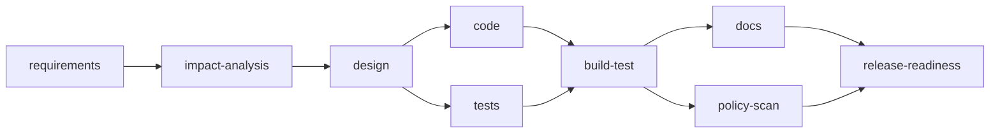

# Architecture

## Overview

- The orchestrator is a Spring Boot app driven from the command line.
- It reads a stage graph from `workflow.yml` and runs each stage with an AI agent.
- Humans approve the decisions that matter: requirements, design and schema, and release.
- Run state lives in a file-based H2 database, so a run can pause for approval and resume later.

## Stage graph

| Stage | Kind | Waits for | Gate |
|---|---|---|---|
| requirements | agent | none | Required sections, then human sign-off |
| impact-analysis | agent | requirements | Required sections. Skipped for greenfield. |
| design | agent | impact-analysis | Required sections, then human approval of design and schema |
| code | files | design | Policy check before files are written |
| tests | files | design | Policy check before files are written |
| build-test | build | code and tests | Real Maven build must pass |
| docs | files | build-test | Policy check before files are written |
| policy-scan | policy-scan | build-test | Rules re-checked over the whole tree |
| release-readiness | agent | docs and policy-scan | Required sections, then human release approval |

- **Agent** stages return text, such as a requirements document.
- **Files** stages return file changes, which are written under `url-shortener/`.
- `code` and `tests` run in parallel. `build-test` joins them.
- `docs` and `policy-scan` run in parallel. `release-readiness` joins them.

## Components

| Package | Role |
|---|---|
| `workflow` | Loads `workflow.yml` and rejects cycles or missing dependencies at startup |
| `engine` | Walks the graph and gives each stage the approved outputs of its upstream stages |
| `agent` | `AgentRuntime` interface, with a mock version and a real GitHub Copilot SDK version |
| `gate` | Exit gates (required headings) and human approvals |
| `policy` | `PolicyGuard` with four rules: secrets, dependency allowlist, schema approval, write path |
| `recovery` | Retries, fallback model, git rollback and safe-stop |
| `replan` | Re-runs a stage and marks everything downstream as stale |
| `state` | Runs, stages, attempts, approvals and decisions, stored in H2 |
| `audit` | One JSON-lines audit file per run |
| `metrics` | Success rate, retry and rollback rates, MTTR and latency |
| `workspace` | Git branch and commits per run, file writing, Maven build and policy scan |
| `evidence` | Exports a run to `scenarios/`, after scanning for secrets and personal data |
| `cli` | The command-line entry point |

## How each orchestration requirement is met

| Requirement | How it works |
|---|---|
| Dependency graph | Declared in `workflow.yml` and validated as a DAG at startup |
| Entry and exit gates | Exit gates check required headings. Entry gates wait for human approval. |
| Parallel paths and sync | Two parallel pairs, each joined before the next stage |
| Cross-stage context | Each stage gets the approved outputs of the stages it depends on |
| Decision lineage | Input, output and upstream hashes are stored for every stage revision |
| Human approval | Requirements sign-off, design and schema approval, release approval |
| Retries and fallback | Two tries on the stage's model, then one on a fallback model |
| Rollback and safe-stop | Failed state is tagged, the branch resets to the last approved commit, and the run stops |
| Policy guardrails | Secret scan, dependency allowlist, schema-change approval, write-path restriction |
| Audit trail | Every event logs run, stage, attempt, model, hashes, decision and actor |
| Reliability metrics | Success rate, retry and rollback rates, MTTR, end-to-end and per-stage latency |
| Re-planning | A re-run marks downstream stages stale. They must pass their gates again. Capped at three revisions. |

## Life of a run

1. `--scenario` starts a run, creates the branch `agent/<scenario>-<run-id>` and runs `requirements`.
2. The run pauses for approval. A human reads the output and runs `--approve`.
3. The engine runs every stage it can until the next approval or a failure.
4. A human can `--reject` with a reason and `--replan`. The stage re-runs with that feedback.
5. `code` and `tests` write files, `build-test` runs Maven, and `policy-scan` re-checks the tree.
6. If a stage still fails after retries, the run rolls back and stops safely.
7. `--export` copies the run's evidence into `scenarios/<name>/`.

## Key decisions

- **Mock and real agent runtimes.** All 283 orchestrator tests run against the mock, so no login or network is needed.
- **File-based H2 for run state.** A run can wait days for approval, so state must outlive the process.
- **One process per CLI command.** Each action is a separate, auditable event. The cost is that flags must be repeated on every command.
- **A git branch per run and a commit per stage.** Every stage output can be inspected, and failed runs are tagged rather than lost.
- **Spring Data JDBC in the shortener.** Plain SQL next to each repository method, with no hidden ORM behavior.
- **No Kafka, external workflow engine or Spring Security.** The orchestration logic is the focus, so it is kept in-process and simple.
