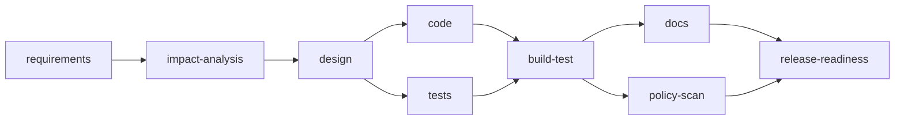

# Architecture

## Overview

The orchestrator turns a natural-language change request into a governed sequence of LLM-backed stages,
each producing a reviewable artifact, with human approval gates on the decisions that matter (requirements
sign-off, schema/API changes, release). It is a Spring Boot application with a CLI front end; state is
persisted to a local file-based H2 database so a run can pause for approval and resume in a later process.

`impact-analysis` is skipped for greenfield changes (there is nothing to analyze impact against). `design`
and `release-readiness` are human approval gates; everything else proceeds automatically once its
dependencies succeed. `build-test` and `release-readiness` are join points: they wait for *both* of their
upstream branches.

## Components

| Package | Responsibility |
|---|---|
| `workflow` | Loads and validates `workflow.yml` as a DAG at startup (`WorkflowDefinition`, `WorkflowLoader`, `WorkflowValidator`). Fails fast on cycles or dangling dependencies. |
| `engine` | `WorkflowEngine` walks the graph, builds `StageContext` (the approved upstream outputs a stage is allowed to see), and delegates each stage to a `StageExecutor`. |
| `agent` | `AgentRuntime` is the LLM abstraction. `MockAgentRuntime` returns deterministic placeholder text for tests and mock-mode runs; `CopilotSdkAgentRuntime` wraps the GitHub Copilot SDK for live runs. `PromptBuilder` assembles the per-stage system prompt (`resources/prompts/*.md`) with the upstream context. `AgentStageExecutor` is the `StageExecutor` for `kind: agent` stages (requirements, impact-analysis, design, docs). |
| `workspace` | Everything that touches the real git repository and the real `url-shortener/` files: `GitWorkspace`/`Git` (one branch per run, one commit per stage), `FileWritingStageExecutor` (`kind: files` — parses the agent's file-change output and writes it under `url-shortener/`, through `PolicyGuard` first), `BuildStageExecutor` (`kind: build` — runs `./mvnw verify` for real), `PolicyScanStageExecutor` (`kind: policy-scan`), `RoutingStageExecutor` (dispatches by `kind`). |
| `gate` | `StageGates` checks a stage's output has every `requiredSections` heading (the exit gate) before it can be considered done; `ApprovalService` records and checks human approvals (the entry gate for the next stage). |
| `policy` | `PolicyGuard` runs a list of `PolicyRule`s over any file change a `files`/`build` stage is about to apply: `SecretScanRule`, `DependencyAllowlistRule` (only approved group IDs), `SchemaChangeRule` (schema/API changes must have a recorded approval), `WritePathRule` (writes must stay under `url-shortener/`). |
| `recovery` | `RetryingStageRunner` retries a failed stage on its own model, then once on a configured fallback model (`RecoveryProperties.fallbackModels`), then gives up. `GitRollbackStrategy` tags the broken state as `agent-failed/<run-id>` and resets the branch to the last approved commit. `ChaosPlan` lets a demo deliberately inject failures to exercise this path. |
| `replan` | `ReplanService` re-runs a stage (on rejection or an explicit `--replan`), bumping its revision; every stage downstream of a changed one is marked `STALE` until it is re-run too, so governance (approvals, gates) is never silently bypassed by a re-plan. Capped at `replan.max-revisions` per stage. |
| `state` | JPA entities persisted to H2: `WorkflowRun`, `StageExecution` (one row per stage per revision, with input/output hashes), `StageAttempt` (one row per retry attempt, with the model used and whether it succeeded), `Approval`, `Decision` (the lineage record: which upstream output hashes fed a given decision). |
| `audit` | `JsonLinesAuditLog` — one append-only `.jsonl` file per run under `runs/audit/`, one line per event, each with run id, stage, attempt, model, input/output hash, decision, and actor. |
| `metrics` | `MetricsService`/`MetricsCalculator` compute success rate, retry rate, rollback rate, and MTTR from the persisted `StageExecution`/`StageAttempt` history. |
| `evidence` | `EvidenceExporter` copies a run's state into `scenarios/<name>/` (request, run summary, stage artifacts, approvals, lineage, metrics, audit log); `EvidenceScanner` scans everything first for secrets, local paths, and personal emails and refuses to write if it finds any. |
| `cli` | `OrchestratorCli` — the only entry point. Start a run, approve/reject/replan a stage, resume a paused run, inspect status/lineage/metrics, export evidence, or preview a single stage. |

## Orchestration model: how the "critical differentiator" requirements are met

- **Explicit dependency graph with entry/exit gates:** `workflow.yml` is a declarative DAG (`dependsOn`),
  validated at startup. Exit gates are `requiredSections` (the stage's own output must contain specific
  markdown headings before it is considered complete). Entry gates are `approval` (the next stage cannot
  start until a human approves).
- **Sequential and parallel paths with synchronization:** `code` and `tests` both depend only on `design`
  and run independently; `build-test` depends on both and is a join point. `docs` and `policy-scan` both
  depend only on `build-test` and run independently; `release-readiness` joins them.
- **Cross-stage context and decision lineage:** `StageContext` carries the *approved* text output of every
  upstream stage into the next one's prompt. Every `Decision` row records the output hash of the stage it
  belongs to and the hashes of everything it was built from, so `--lineage=<run>` can show exactly which
  revision of which upstream stage produced a given result — and whether it is now stale.
- **Human approval checkpoints:** `requirements-signoff`, `design-and-schema`, and `release` are hard gates;
  nothing proceeds past them without a recorded `Approval`.
- **Bounded retries, fallback, rollback, safe-stop:** `RetryingStageRunner` retries once on the stage's own
  model and once on a configured fallback, then the run is marked `SAFE_STOPPED` and `GitRollbackStrategy`
  resets the branch to the last approved commit, preserving the failed state at an `agent-failed/<run-id>`
  tag rather than losing it.
- **Policy guardrails:** `PolicyGuard`'s four rules run before any file change from a `files`/`build` stage
  is applied, not after.
- **Audit-grade observability:** every stage transition, approval, rejection, and re-plan is a line in the
  run's `.jsonl` audit log, with hashes rather than full content, so the log itself cannot leak secrets.
- **Reliability metrics:** success rate, retry/rollback frequency, and MTTR are computed from the same
  persisted history the audit log is built from, available via `--metrics`.
- **Dynamic re-planning with governance preserved:** `--replan`/`--reject --replan` re-run a stage and mark
  every downstream stage `STALE`; a stale stage must be re-run and, if it has its own approval gate, must be
  re-approved — a re-plan can never skip governance that a first pass would have required.

## Key decisions

- **File-based H2, not in-memory, for orchestrator state.** A run can pause for days waiting on a human
  approval; the state has to survive the CLI process exiting between invocations.
- **One CLI invocation per command, not a long-running server.** Simpler to reason about and to audit each
  action as a discrete, attributable event; the trade-off (documented in `docs/RISKS.md`) is that any
  per-invocation JVM property — notably `--orchestrator.agent.mode=copilot` — must be repeated on every
  single command for a run, which is an easy operator mistake.
- **`AgentRuntime` as an interface with a mock and a real implementation.** The whole engine, gate, policy,
  recovery, and replan logic is tested against `MockAgentRuntime` (283 tests, no network, no login needed);
  only the three live scenario runs used `CopilotSdkAgentRuntime` against the real GitHub Copilot SDK.
- **Spring Data JDBC, not JPA, for `url-shortener`.** Deliberately minimal: no Hibernate session lifecycle,
  no lazy-loading surprises, SQL is plain and visible in `@Query` annotations next to the repository method
  it belongs to.
- **No Kafka, no external workflow engine, no Spring Security.** Explicitly out of scope per the project's
  own engineering rules — the orchestration logic itself is the thing being demonstrated, not a
  distributed-systems exercise.
- **One git branch per run, one commit per stage, tag-don't-delete on failure.** Every stage's output is a
  real, inspectable commit; a failed run's broken state is still fully available at its tag for exactly the
  kind of file-by-file forensic review the brownfield and ambiguous-analytics scenarios needed.

## Control flow for a single run

1. `--scenario=<name> --change-type=<greenfield|brownfield> --request=<text>` creates a `WorkflowRun`, a
   new branch `agent/<scenario>-<run-id>`, and runs `requirements`. It pauses `AWAITING_APPROVAL`.
2. A human reviews the stage's markdown output and runs `--approve=<run>:requirements`. The engine resumes,
   running every stage reachable until the next approval gate or a terminal state (`FAILED`/`SAFE_STOPPED`).
3. If a stage output is wrong, `--reject=<run>:<stage> --reason=<text> --replan` re-runs it with the
   rejection reason fed into its prompt, and marks everything downstream `STALE`.
4. `code`/`tests` write real files under `url-shortener/` through `PolicyGuard`; `build-test` runs the real
   Maven build; `policy-scan` re-checks the whole tree.
5. On any stage failure after retries are exhausted, the run safe-stops and rolls back, preserving the
   failure at a git tag.
6. `--export=<run> --to=scenarios/<name>` copies the run's full evidence out for human-written docs and
   PR review.
